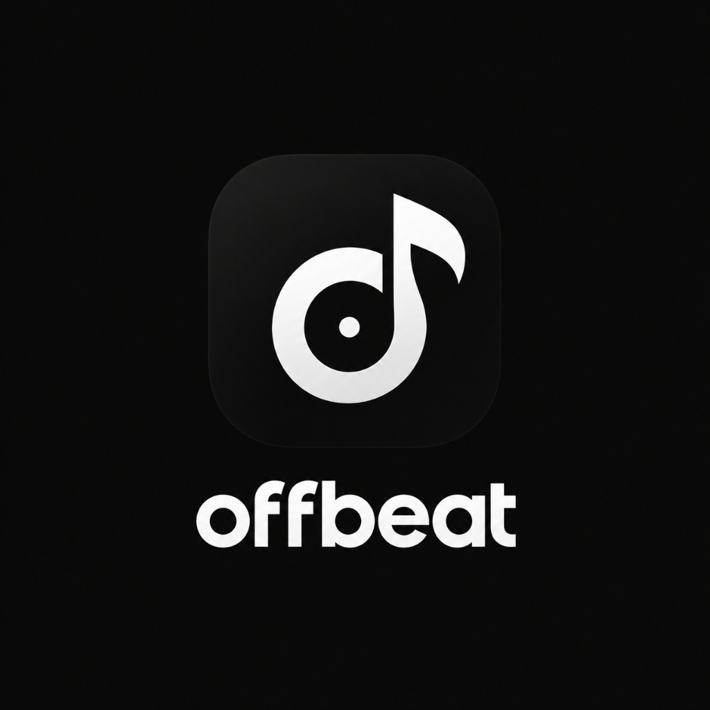

<div align="center">

  

  # OffBeat
  
  **A high-performance, production-grade local music player for Android built with Flutter.**

  [](https://flutter.dev)
  [](https://dart.dev)
  [](https://riverpod.dev)
  [](https://drift.simonbinder.eu)
  [](https://github.com/media-kit/media-kit)
  [](https://android.com)

  <p align="center">
    OffBeat is designed for audiophiles and everyday music lovers who want a blistering-fast, distraction-free offline listening experience. Engineered with hardware-accelerated playback, an adaptive 60 FPS motion engine, and a striking Dark Navy / Clean Light design language.
  </p>

</div>

---

## 📑 Table of Contents

- [✨ Overview](#-overview)
- [🚀 Key Features](#-key-features)
  - [🎧 Audiophile-Grade Playback](#-audiophile-grade-playback)
  - [🎨 Design & Motion Aesthetics](#-design--motion-aesthetics)
  - [📚 Library & Queue Management](#-library--queue-management)
  - [⚡ Performance & Low-End Optimization](#-performance--low-end-optimization)
  - [🛡️ Android System Reliability](#️-android-system-reliability)
- [🏗️ Architecture & Tech Stack](#️-architecture--tech-stack)
  - [Technology Stack](#technology-stack)
  - [Directory Structure](#directory-structure)
- [📱 Supported Formats & Codecs](#-supported-formats--codecs)
- [🛠️ Getting Started](#️-getting-started)
  - [Prerequisites](#prerequisites)
  - [Installation & Build](#installation--build)
- [🔐 Permissions & Android Lifecycle](#-permissions--android-lifecycle)
- [🤝 Contributing](#-contributing)
- [📄 License](#-license)

---

## ✨ Overview

Unlike bloated streaming apps or clunky legacy media players, **OffBeat** is built from the ground up for **local-first speed, stability, and elegance**:

- **Hardware Decoding**: Powered by `media_kit` (libmpv backend) for seamless gapless playback, low-latency seeking, and uncompromised audio quality.
- **Background Native Audio**: Integrated with Android's `MediaBrowserServiceCompat` via `audio_service`, featuring ongoing lockscreen controls, notification actions, and proper audio focus management.
- **Adaptive 60 FPS Motion**: Built with a dedicated physics and motion design system that dynamically detects hardware capabilities (e.g. low-RAM devices or Android 10/SDK 29) to throttle heavy effects and maintain a consistent 60 frames per second.
- **Local Persistence**: Powered by SQLite through `Drift`, ensuring rapid instant caching of playlists, favorites, and play history with zero network dependency.

---

## 🚀 Key Features

### 🎧 Audiophile-Grade Playback
- **Universal Codec Support**: High-performance playback of MP3, FLAC, WAV, AAC, OGG, OPUS, and M4A.
- **Real-Time Technical Specs**: Inspect active track bitrate (e.g. 320 kbps, 1411 kbps), sample rate (44.1 kHz, 96 kHz, 192 kHz), channel configuration (stereo/surround), and total file size directly in the Now Playing screen.
- **Audio Focus & Interruption Handling**:
  - Automatically ducks playback volume to 40% for navigation alerts or notifications.
  - Automatically pauses on incoming calls and resumes on call termination.
  - Pauses instantly when wired headphones are unplugged or Bluetooth disconnects (`BECOMING_NOISY`).
- **Flexible Playback Modes**: Repeat Track, Repeat All, Shuffle, and seamless queue manipulation.

### 🎨 Design & Motion Aesthetics
- **Curated Theme System**:
  - **Dark Navy (`#171C26`)**: Deep contrast with card surfaces (`#1E2430`) and active accents.
  - **Clean White (`#FFFFFF`)**: Fresh, modern daytime mode with high-contrast slate tones.
  - Smooth 250ms cross-fade theme transitions with rotational toggle micro-interactions.
- **Floating App Dock & Mini Player**:
  - Persistent bottom dock housing the interactive 4-tab navigation system.
  - Floating mini player with progress tracker, play/pause controls, and smooth upward slide-to-expand transition into Now Playing.
- **Dynamic Now Playing Screen**:
  - Staggered entrance choreographies (artwork -> title marquee -> seekbar -> playback controls).
  - Background live audio waveform visualization.
  - Text Marquee for long song/artist titles (automatically pauses during route transitions to eliminate frame drops).
  - High-res artwork with dual-tier thumbnail and full-size caching.

### 📚 Library & Queue Management
- **Single-Flight MediaStore Scanner**:
  - Scans Android MediaStore safely without blocking the UI thread.
  - Eliminates notification ringtones and micro-clips shorter than 5 seconds.
  - In-Dart derivation of albums and artists to prevent vendor-specific MediaStore query bugs.
- **Library Categories**:
  - **Songs**: Alphabetical, date-added, and duration indexing.
  - **Albums**: Grid cards with artwork previews, release year, and track counts.
  - **Artists**: Discography grouping with album and track aggregation.
  - **Playlists**: User-created playlists with reordering and bulk track management.
- **Hotlist**: One-tap access to your favorite and starred tracks with instant "Play All" and "Shuffle" actions.
- **Up Next Sheet**: Interactive modal sheet allowing drag-and-drop queue reordering, track removal, and instant track skipping.
- **Quick Actions Menu**: Convenient bottom sheet on every track offering "Play Next", "Add to Queue", "Toggle Favorite", and "Add to Playlist".

### ⚡ Performance & Low-End Optimization
- **Hardware-Tier Adaptation**: Startup detection via `DeviceInfoPlugin` identifies low-RAM hardware (`ActivityManager.isLowRamDevice` or SDK &le; 29) to automatically scale animation durations (60%) and replace heavy slide transforms with lightweight opacity fades.
- **Bounded Image Cache**: In-memory decoded image cache capped at 150 items / 60 MB to prevent Garbage Collection (GC) pauses and out-of-memory errors on 2GB–3GB RAM devices.
- **Jank Logging**: Built-in debug frame timing callback (`WidgetsBinding.instance.addTimingsCallback`) flagging any frame renders exceeding 16.6 ms.
- **Accessibility Friendly**: Respects Android's system-level *"Remove animations"* setting via `MediaQuery.maybeDisableAnimationsOf(context)`.

### 🛡️ Android System Reliability
- **Battery Optimization Whitelist Prompt**: Single-tap setting in Diagnostics to request `REQUEST_IGNORE_BATTERY_OPTIMIZATIONS`, ensuring aggressive OEM task killers (MIUI, EMUI, ColorOS, OneUI) do not terminate background playback.
- **Crash Logger**: In-app crash report viewer and diagnostic exporter with one-click clipboard copying.

---

## 🏗️ Architecture & Tech Stack

OffBeat follows **Feature-First + Layered Architecture** with Riverpod for state management:

```
lib/
├── core/                  # Design tokens, theme, motion curves, permissions & utilities
│   ├── constants.dart     # Color tokens (Navy, Slate), radii, and spacing
│   ├── crash_logger.dart  # Unhandled exception persistence and log reader
│   ├── formatters.dart    # Time duration, audio bitrate/kHz, and file size formatters
│   ├── motion.dart        # Unified animation durations, curves & low-end adaptation
│   ├── permission_service.dart # Android 13+ vs <=12 storage & notification permission handler
│   ├── theme.dart         # Material 3 light/dark ThemeData specifications
│   └── theme_provider.dart# Riverpod state notifier for Dark/Light/System theme mode
│
├── data/                  # Data layer: SQLite DB, scanners, repositories & artwork
│   ├── artwork/           # Dual-tier thumbnail & high-res artwork loader with caching
│   ├── audio_query_gate.dart # Concurrency gate for MediaStore queries
│   ├── db/                # Drift SQLite database (Favorites, Playlists, RecentlyPlayed)
│   ├── models/            # Immutable data models (Song, Album, Artist, Playlist)
│   ├── repository/        # MusicRepository coordinating DB, scanner, and streams
│   └── scanner/           # MusicScanner extracting metadata and deriving relations
│
├── features/              # Feature modules (UI screens and view models)
│   ├── album_detail/      # Album view with track list and artwork header
│   ├── home/              # Main feed: Recently played carousel, album grid, quick picks
│   ├── hotlist/           # Starred and favorite tracks with Play All & Shuffle
│   ├── library/           # 4-tab library (Songs, Albums, Artists, Playlists)
│   ├── now_playing/       # Full-screen player, Up Next sheet, waveform & specs
│   ├── permission/        # Storage permission rationale & onboarding screen
│   ├── playlists/         # Playlist detail and creation dialogs
│   ├── search/            # Instant debounced search across songs, artists & albums
│   ├── settings/          # Theme picker, library rescan, battery exemption & crash logs
│   └── splash/            # Application splash and initialization
│
├── playback/              # Audio playback engine
│   ├── audio_controller.dart # High-level playback actions (play, pause, next, queue)
│   └── audio_handler.dart    # Background AudioService handler with media_kit backend
│
├── shared/widgets/        # Reusable design components
│   ├── action_menu_sheet.dart# Track contextual action menu
│   ├── album_grid_card.dart  # Rounded album art card with press animation
│   ├── app_dock.dart         # Floating dock combining mini player and navigation bar
│   ├── background_waveform.dart # Procedural animated playback waveform
│   ├── control_buttons.dart  # Skip, play/pause, seek, and loop controls
│   ├── marquee_text.dart     # Auto-scrolling text for overflowing track titles
│   ├── mini_player.dart      # Expandable bottom-dock mini player
│   ├── nav_bar.dart          # 4-tab floating navigation bar
│   ├── pressable.dart        # Spring scale feedback on tap
│   └── song_row_tile.dart    # High-performance virtualized song row item
│
└── main.dart              # App bootstrap, Riverpod overrides, GoRouter & lifecycle
```

### Technology Stack

| Category | Package / Tool | Version | Purpose |
|---|---|---|---|
| **Framework** | Flutter / Dart SDK | `^3.13.5` | Cross-platform core framework |
| **State Management** | `flutter_riverpod` | `^3.4.3` | Reactive dependency injection & state providers |
| **Routing** | `go_router` | `^18.0.2` | Declarative URL-like routing with permission guards |
| **Audio Playback Engine** | `media_kit` + `media_kit_libs_android_audio` | `^1.2.6` / `^1.3.8` | High-fidelity hardware-accelerated audio decoding |
| **Background Service** | `audio_service` + `audio_session` | `^0.18.19` / `^0.2.4` | Android Foreground Service, lockscreen notifications & audio focus |
| **Local Database** | `drift` + `sqlite3_flutter_libs` | `^2.35.2` | Type-safe SQLite persistence for favorites, playlists, and history |
| **MediaStore Queries** | `on_audio_query_forked` | `^2.9.1` | Native Android MediaStore audio indexer |
| **Tag Extraction** | `audio_metadata_reader` | `^1.8.0` | Fallback ID3/FLAC metadata and embedded cover extraction |
| **Preferences** | `shared_preferences` | `^2.5.6` | Theme mode & user preference storage |
| **Typography** | `google_fonts` (Inter) | `^9.0.0` | Modern, clean typographic hierarchy |
| **Device Info** | `device_info_plus` | `^13.3.0` | Android SDK level & low-RAM detection |
| **Permissions** | `permission_handler` | `11.3.1` | Storage & notification runtime permission flows |

---

## 📱 Supported Formats & Codecs

OffBeat leverages `media_kit` (backed by libmpv), providing out-of-the-box decoding for:

- **Lossless**: FLAC (`.flac`), ALAC (`.m4a`), WAV (`.wav`), AIFF (`.aiff`)
- **Lossy**: MP3 (`.mp3`), AAC / M4A (`.aac`, `.m4a`), OGG Vorbis (`.ogg`), Opus (`.opus`), WMA (`.wma`)
- **Sample Rates**: Standard 44.1 kHz / 48 kHz up to Hi-Res 96 kHz / 192 kHz audio.

---

## 🛠️ Getting Started

### Prerequisites
- **Flutter SDK**: `>= 3.13.5` ([Install Flutter](https://docs.flutter.dev/get-started/install))
- **Android Studio / SDK**: Android SDK 34, Android NDK (required for media_kit audio binaries)
- **Dart SDK**: Compatible with Flutter 3.13+

### Installation & Build

1. **Clone the repository**:
   ```bash
   git clone https://github.com/abirsiddiky/OffBeat.git
   cd OffBeat
   ```

2. **Install Flutter dependencies**:
   ```bash
   flutter pub get
   ```

3. **Generate Drift Database Code**:
   Run `build_runner` to generate `app_database.g.dart`:
   ```bash
   dart run build_runner build --delete-conflicting-outputs
   ```

4. **Run the App in Debug Mode**:
   Connect an Android device (or launch an emulator) and execute:
   ```bash
   flutter run
   ```

5. **Build Release APK**:
   ```bash
   flutter build apk --release
   ```
   The APK will be located at `build/app/outputs/flutter-apk/app-release.apk`.

---

## 🔐 Permissions & Android Lifecycle

OffBeat requests only the minimal permissions required to index your offline audio library and play music in the background:

- **`READ_MEDIA_AUDIO`** *(Android 13+ / API 33+)*: Access to audio files stored on the device.
- **`READ_EXTERNAL_STORAGE`** *(Android 12 and below / API &le; 32)*: Access to local music on older Android versions.
- **`POST_NOTIFICATIONS`** *(Android 13+ / API 33+)*: Displays playback notification with media controls.
- **`FOREGROUND_SERVICE` & `FOREGROUND_SERVICE_MEDIA_PLAYBACK`**: Ensures background playback is not killed when the app is minimized.
- **`WAKE_LOCK`**: Keeps CPU awake during audio decoding with screen turned off.
- **`REQUEST_IGNORE_BATTERY_OPTIMIZATIONS`**: Optional user toggle in Settings to prevent aggressive OEM battery managers from abruptly terminating audio playback.

The app incorporates an automatic permission recovery bridge: if permissions are revoked, the app gracefully navigates to `PermissionScreen` and detects app-resume events via `WidgetsBindingObserver` to re-verify permissions seamlessly.

---

## 🤝 Contributing

Contributions, feature requests, and bug reports are welcome!

1. **Fork the Project**
2. **Create your Feature Branch** (`git checkout -b feature/AmazingFeature`)
3. **Commit your Changes** (`git commit -m 'Add some AmazingFeature'`)
4. **Push to the Branch** (`git push origin feature/AmazingFeature`)
5. **Open a Pull Request**

---

## 📄 License

Distributed under the **MIT License**. See `LICENSE` for more information.

<div align="center">
  <br />
  <sub>Built with ❤️ using Flutter and Riverpod. Crafted for music enthusiasts.</sub>
</div>
