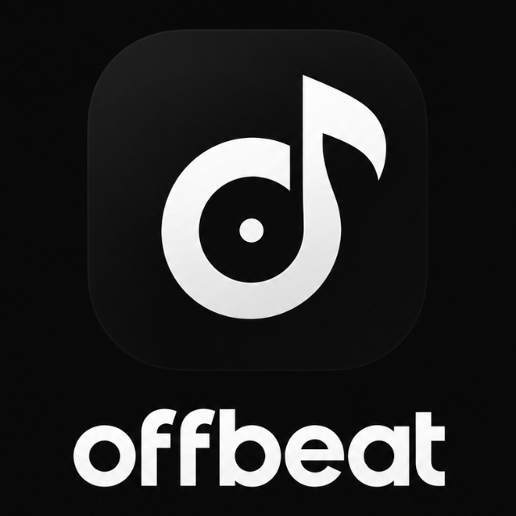

# OffBeat

<p align="center">
  
</p>

<p align="center">
  <strong>A minimal, local-first music player built with Flutter.</strong><br>
  Engineered to play every audio format you throw at it with high fidelity, zero telemetry, and an ultra-clean modern aesthetic.
</p>

<p align="center">
  
  
  
  
  
</p>

---

## ✨ Features

- **Universal Codec Support** — Powered by `media_kit` (libmpv / FFmpeg). Seamlessly decodes MP3, AAC, M4A, FLAC, WAV, OGG/Vorbis, OPUS, ALAC, APE, WMA, and more without external plugins or third-party transcoding.
- **Real-Time Audio Quality Inspector** — Live inspection of audio stream properties displaying native badges for codec format, sample rate (e.g. `44.1 kHz`), bit depth (`16-bit` / `24-bit`), and bit rate (`320 kbps`).
- **On-Device Library Scanning** — Automatically indexes all audio files on device storage via Android MediaStore and groups them into Songs, Albums, Artists, and Playlists.
- **Background Playback & Lock-Screen Controls** — Full integration with Android `AudioService` and media session notifications for background playback, headphone controls, and lock-screen media display.
- **Queue & Playback Control** — Dynamic queue manipulation (Play Next, Add to Queue, Reorder, Shuffle, Repeat All, Repeat One, Repeat Off).
- **Dynamic Waveform Seek Bar** — Precision seeking with an interactive thin scrubber, responsive thumb indicator, and decorative background waveform reveal.
- **Auto-Scrolling Marquee Typography** — Smooth, bidirectional scrolling marquee with soft edge-fade masks for long track names and artist metadata.
- **Hotlist & Favorites** — Fast one-tap track favoriting persisted locally in SQLite.
- **Custom Playlists** — Create, rename, delete, and curate custom playlists.
- **Recently Played History** — Tracks listening history automatically on your device.
- **Light & Dark Theme Engine** — Instant one-tap switching between Clean Light Mode and Deep Navy Dark Mode, complete with smooth flip-fade animations and system preference synchronization.
- **Integrated Native & In-App Splash** — Seamless `#090909` dark launch screen transitioning effortlessly into the app.

---

## 🛠 Tech Stack

| Layer | Library / Tool | Purpose |
|---|---|---|
| **Framework** | [Flutter](https://flutter.dev) (Dart 3) | Cross-platform UI toolkit |
| **Audio Core** | [`media_kit`](https://pub.dev/packages/media_kit) + `media_kit_libs_audio` | High-performance audio engine backed by libmpv & FFmpeg |
| **Background Playback** | [`audio_service`](https://pub.dev/packages/audio_service) + [`audio_session`](https://pub.dev/packages/audio_session) | Background execution, lock-screen notifications, audio focus |
| **Media Scanning** | [`on_audio_query_forked`](https://pub.dev/packages/on_audio_query_forked) | Android MediaStore audio indexing and metadata extraction |
| **Local Persistence** | [`drift`](https://pub.dev/packages/drift) + `sqlite3_flutter_libs` | Reactive, type-safe SQLite database for favorites, playlists, and history |
| **State Management** | [`flutter_riverpod`](https://pub.dev/packages/flutter_riverpod) | Declarative state management and dependency injection |
| **Routing** | [`go_router`](https://pub.dev/packages/go_router) | Declarative, URL-driven routing with stateful shell branches |
| **Typography** | [`google_fonts`](https://pub.dev/packages/google_fonts) | Inter modern sans-serif typography |
| **Preferences** | [`shared_preferences`](https://pub.dev/packages/shared_preferences) | Local persistence of theme mode and user preferences |
| **Permissions** | [`permission_handler`](https://pub.dev/packages/permission_handler) | Runtime Android storage & audio permission requests |

**Minimum Android SDK:** API 24 (Android 7.0 Nougat)  
**Target Android SDK:** API 34+ (Android 14+)

---

## 🎨 Design System

OffBeat follows an intentional, distraction-free aesthetic with high contrast, generous tap targets, and smooth micro-animations.

### Color Tokens

| Token | Hex | Usage |
|---|---|---|
| **Deep Dark** | `#090909` | Splash screen background, app icon backdrop |
| **Navy** | `#171C26` | Dark surface, dark cards, light-theme primary text |
| **Accent / Indigo** | `#4F46E5` | Interactive highlights, active progress slider |
| **Slate** | `#6C7689` | Secondary text, inactive tab items, timestamps |
| **Light Slate** | `#A4AAB7` | Borders, subtle dividers, disabled controls |
| **Clean White** | `#FFFFFF` | Light-theme background, dark-theme primary text |

### Component Styling
- **Rounded Radii:** Standardized corner scales (`16px`, `24px`, `32px`).
- **Floating Pill Navigation:** Floating bottom navigation bar with blur/tint docked above system insets.
- **Docked Mini Player:** Persistent playback bar accessible across all primary tabs with gesture-based progress and transport.
- **Monochrome & Adaptive Artworks:** Balanced fallback artwork for tracks lacking embedded album art.

---

## 📱 Screens & Navigation

```
              ┌─────────────────────────────┐
              │     Splash Screen (/splash) │
              └──────────────┬──────────────┘
                             │
                             ▼
              ┌─────────────────────────────┐
              │   Floating Nav Shell Route  │
              └──────────────┬──────────────┘
         ┌───────────┬───────┴────────┬───────────┐
         ▼           ▼                ▼           ▼
      [Home]      [Search]        [Library]   [Hotlist]
         │                            │
         │                            ├─ Songs
         │                            ├─ Albums ──► [Album Detail (/album/:id)]
         │                            ├─ Artists
         │                            └─ Playlists
         ▼
[Now Playing Screen (/now-playing)]
```

- **Splash Screen (`/splash`)**: Zero-flash launch screen featuring the animated OffBeat squircle badge and subtle progress indicator.
- **Home Screen (`/home`)**: Quick rescan, theme switch, horizontal Recently Played carousel, and quick-access Album grid.
- **Search Screen (`/search`)**: Real-time debounce search indexing titles, artists, and albums simultaneously.
- **Library Screen (`/library`)**: Tabbed overview of Songs, Albums, Artists, and Custom Playlists with sort and filter options.
- **Album Detail (`/album/:id`)**: Comprehensive album view featuring track listings, total duration, Play All, and Shuffle All.
- **Now Playing (`/now-playing`)**: Immersive full-screen playback screen equipped with:
  - High-res artwork with ambient shadow
  - Marquee track title & artist
  - Live audio quality badges (Codec, Sample Rate, Bit Depth, Bitrate)
  - Interactive waveform seek bar
  - Full transport controls (Shuffle, Prev, Play/Pause, Next, Repeat, Favorite, Queue)
- **Hotlist (`/hotlist`)**: Instant access to your curated favorite tracks.

---

## 🏗 Project Structure

```
OffBeat/
├── android/                         # Native Android configuration, Gradle files & resources
│   └── app/src/main/
│       ├── AndroidManifest.xml      # Permissions, services & receiver definitions
│       └── res/                     # Launcher mipmaps (adaptive & round), drawables & splash styles
├── assets/
│   └── images/                      # Official app icons, badges, and splash assets
├── lib/
│   ├── core/
│   │   ├── router/                  # go_router configuration & route hierarchy
│   │   └── theme/                   # Color palette, themes, radii & ThemeNotifier
│   ├── data/
│   │   ├── local/                   # Drift SQLite database & table schemas
│   │   ├── models/                  # Audio models (Song, Album, Artist, Playlist)
│   │   ├── providers/               # Riverpod data providers & state notifiers
│   │   ├── repositories/            # MusicRepository interface & implementation
│   │   └── services/                # MediaStore music scanner & permission service
│   ├── features/
│   │   ├── album_detail/            # Album view with track list & play actions
│   │   ├── home/                    # Dashboard with recently played & albums grid
│   │   ├── hotlist/                 # Favorited songs view
│   │   ├── library/                 # Songs, Albums, Artists & Playlists tabs
│   │   ├── now_playing/             # Fullscreen player with waveform & audio info
│   │   ├── search/                  # Instant query filtering
│   │   └── splash/                  # Animated launch splash screen
│   ├── playback/
│   │   ├── audio_handler.dart       # Background AudioService & media_kit bridge
│   │   └── player_controller.dart   # Playback state provider & controller methods
│   ├── shared/
│   │   └── widgets/                 # FloatingNavBar, MiniPlayer, WaveformSeekBar, MarqueeText, etc.
│   └── main.dart                    # App entry point, background service init & ProviderScope
├── pubspec.yaml                     # Dependencies and asset declarations
└── README.md
```

---

## 🔑 Android Permissions

OffBeat is local-first and does **not** require internet access. It requires permissions strictly for reading local media files and running uninterrupted background playback:

| Permission | Android Versions | Justification |
|---|---|---|
| `READ_MEDIA_AUDIO` | Android 13+ (API 33+) | Scans audio files from local shared device storage. |
| `READ_EXTERNAL_STORAGE` | Android 12 and below | Scans music files on older Android devices (`maxSdkVersion 32`). |
| `FOREGROUND_SERVICE` | All | Keeps playback alive when the app is in the background. |
| `FOREGROUND_SERVICE_MEDIA_PLAYBACK` | Android 14+ (API 34+) | Declares media playback foreground service compliance. |
| `POST_NOTIFICATIONS` | Android 13+ (API 33+) | Displays playback notification and lock-screen transport controls. |
| `WAKE_LOCK` | All | Prevents system CPU sleep from interrupting audio playback. |

---

## 🚀 Build Guide

### Prerequisites
- **Flutter SDK:** `^3.13.5` or higher
- **Dart SDK:** `^3.0.0`
- **JDK:** Java 17 or Java 21
- **Android SDK:** Platform tools & API 34+ installed

### Step-by-Step Instructions

1. **Clone the repository:**
   ```bash
   git clone https://github.com/abirsiddiky/OffBeat.git
   cd OffBeat
   ```

2. **Install Flutter dependencies:**
   ```bash
   flutter pub get
   ```

3. **Generate code (Drift database schema):**
   ```bash
   dart run build_runner build --delete-conflicting-outputs
   ```

4. **Run on a connected Android device or emulator:**
   ```bash
   flutter run
   ```

5. **Build release APK:**
   ```bash
   flutter build apk --release
   ```
   The compiled APK will be located at `build/app/outputs/flutter-apk/app-release.apk`.

---

## 📄 License

```text
MIT License

Copyright (c) 2026 Abir Siddiky

Permission is hereby granted, free of charge, to any person obtaining a copy
of this software and associated documentation files (the "Software"), to deal
in the Software without restriction, including without limitation the rights
to use, copy, modify, merge, publish, distribute, sublicense, and/or sell
copies of the Software, and to permit persons to whom the Software is
furnished to do so, subject to the following conditions:

The above copyright notice and this permission notice shall be included in all
copies or substantial portions of the Software.

THE SOFTWARE IS PROVIDED "AS IS", WITHOUT WARRANTY OF ANY KIND, EXPRESS OR
IMPLIED, INCLUDING BUT NOT LIMITED TO THE WARRANTIES OF MERCHANTABILITY,
FITNESS FOR A PARTICULAR PURPOSE AND NONINFRINGEMENT. IN NO EVENT SHALL THE
AUTHORS OR COPYRIGHT HOLDERS BE LIABLE FOR ANY CLAIM, DAMAGES OR OTHER
LIABILITY, WHETHER IN AN ACTION OF CONTRACT, TORT OR OTHERWISE, ARISING FROM,
OUT OF OR IN CONNECTION WITH THE SOFTWARE OR THE USE OR OTHER DEALINGS IN THE
SOFTWARE.
```
